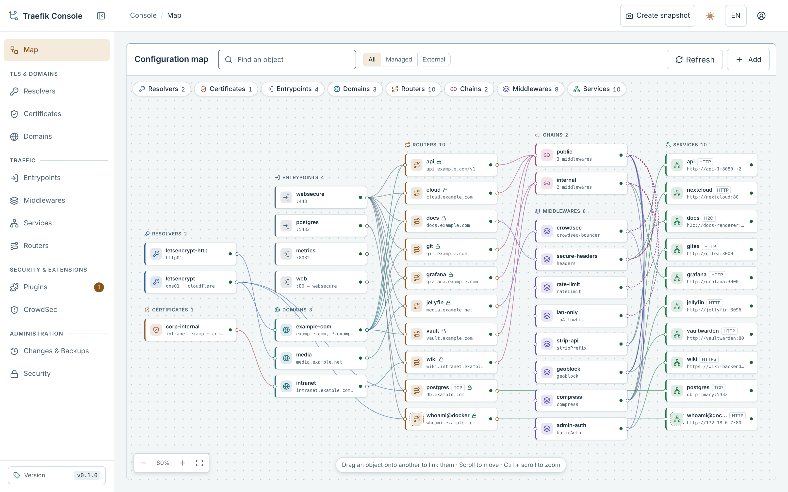
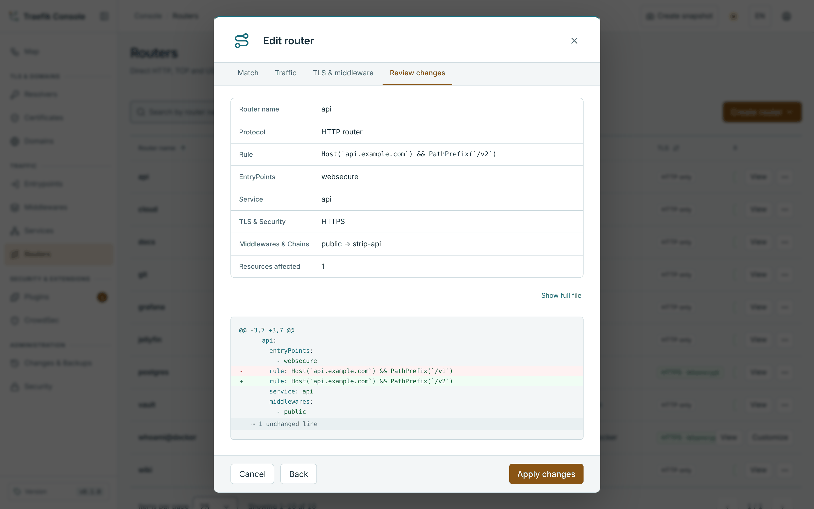
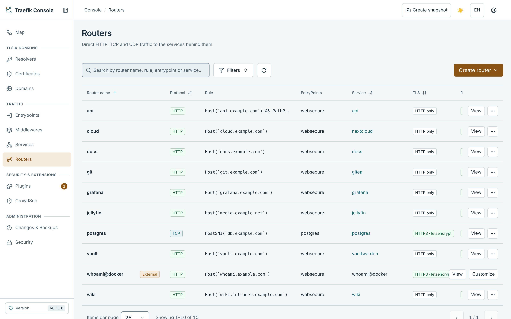
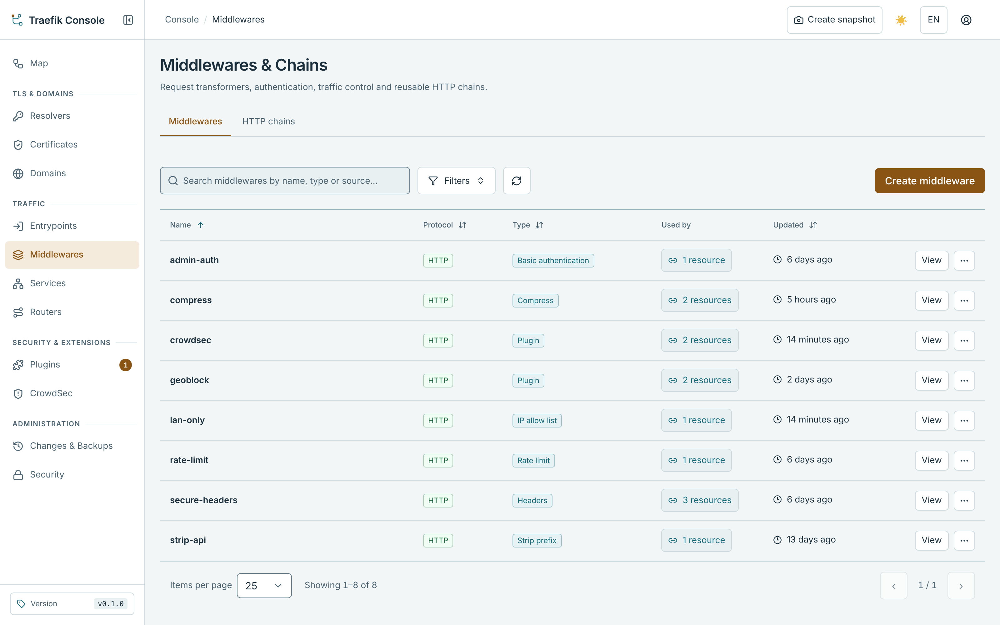
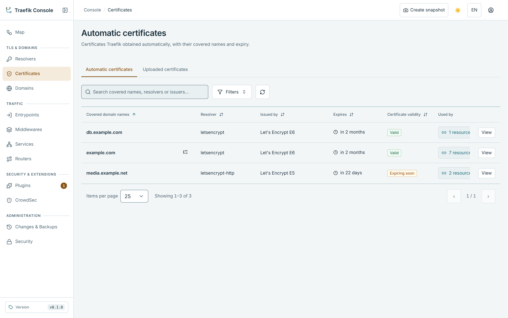
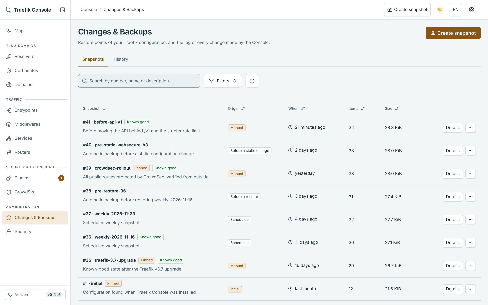
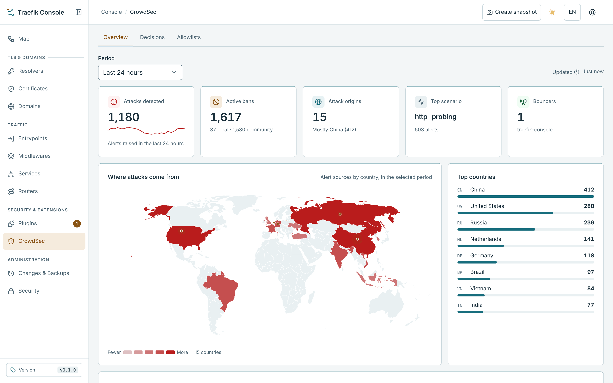

<div align="center">

<picture>
  <source media="(prefers-color-scheme: dark)" srcset="docs/assets/brand/logo-dark.svg">
  
</picture>

<p><strong>Run Traefik from a browser, without hand-editing YAML or losing track of what changed.</strong></p>

[](https://github.com/fouad-aniq/Traefik-Console/releases)
[](https://github.com/fouad-aniq/Traefik-Console/pkgs/container/traefik-console)
[](#deployment)
[](LICENSE)

[Quick start](#quick-start) · [Screenshots](#screenshots) · [Features](#features) · [Deployment](#deployment) · [How it works](#how-it-works)

</div>

<br>

<picture>
  <source media="(prefers-color-scheme: dark)" srcset="docs/assets/screenshots/map-dark.png">
  
</picture>

<br>

Traefik Console is a self-hosted web UI for Traefik's file provider. You build
routes, services, middlewares, domains and certificates in forms and see the exact
YAML change before it is written. Every change is journaled, checked against the
running Traefik, and rolled back if Traefik rejects it.

It works with the Traefik you already have, or starts a new one for you. Your
Docker labels and your own YAML files keep working: Console only writes the files
it owns. Add CrowdSec and the same UI shows alerts and decisions, and protects the
routes you choose.

|   |   |
|---|---|
| **See** | One map of every entrypoint, route, middleware, service and certificate, how they connect, and what Traefik is actually running. |
| **Change safely** | Preview, apply, verify. If something goes wrong, roll back to any snapshot. |
| **Protect** | Sign in with a password or your identity provider, put CrowdSec in front of the routes you choose, and keep an emergency way back in if a route ever breaks. |

## Quick start

Download the Compose bundle from the [latest release](https://github.com/fouad-aniq/Traefik-Console/releases),
create the data folders and start it:

```sh
curl -fsSL https://github.com/fouad-aniq/Traefik-Console/releases/latest/download/traefik-console-deploy.tar.gz | tar -xz
cd traefik-console-deploy/traefik-console
mkdir -p config/traefik/acme data/logs data/plugins data/console
docker compose up -d && docker compose logs console | grep TCS-
```

Open `http://localhost:8081`, paste the setup token from the logs and create your
account. Every setting lives in that folder's `docker-compose.yml`. The
[deployment guide](deploy/README.md) covers the other setups, backups and upgrades.

## Screenshots

<table>
  <tr>
    <td width="50%" valign="top">
      
      <p><strong>Review before apply.</strong> Every edit ends on the exact YAML diff. Nothing is written until you apply it.</p>
    </td>
    <td width="50%" valign="top">
      
      <p><strong>Routers.</strong> HTTP, TCP and UDP routers in one list. Routers from Docker labels show up read-only.</p>
    </td>
  </tr>
  <tr>
    <td width="50%" valign="top">
      
      <p><strong>Middlewares and chains.</strong> Native and plugin middlewares, with where each one is used.</p>
    </td>
    <td width="50%" valign="top">
      
      <p><strong>Certificates.</strong> Let's Encrypt and uploaded certificates, with the names they cover and when they expire.</p>
    </td>
  </tr>
  <tr>
    <td width="50%" valign="top">
      
      <p><strong>Changes and backups.</strong> Named, pinned and automatic snapshots. Compare any two, restore any one.</p>
    </td>
    <td width="50%" valign="top">
      
      <p><strong>CrowdSec.</strong> Alerts, bans and where attacks come from, next to the routes they target.</p>
    </td>
  </tr>
</table>

<sub>Screenshots use example data: the domains are reserved example names and the IP addresses are not real traffic.</sub>

## Features

**Configuration map.** Every object and its references on one left-to-right graph:
certificates and resolvers, domains, entrypoints, routes, chains, middlewares and
services. Drag one object onto another to link them. Broken references show up as
broken objects.

**Routes and services.** Match on a managed domain, a hostname or a custom rule.
Pick entrypoints, ordered middlewares and chains, and TLS. Services take ordered
HTTP, HTTPS and h2c backends with health checks and TLS verification, plus a
read-only view of what Traefik is running.

**Middlewares and chains.** Forms generated from Traefik's own middleware schema,
or plain YAML if you prefer. Plugin middlewares, ordered chains, usage tracking,
and delete guards so you never remove something still in use.

**Domains and certificates.** Let's Encrypt resolvers with guided DNS-01 forms for
Cloudflare, DigitalOcean, Hetzner, OVH, Namecheap, DuckDNS, Azure DNS and Google
Cloud DNS; HTTP and TLS challenges; uploaded certificates; and a live check of the
certificate Traefik serves for each domain.

**Plugins.** Add plugins from the Traefik plugin catalog with their versions, see
which ones have updates, and remove them once nothing uses them.

**Preview before apply.** Every change is a dry run first. You see the resulting
YAML, then apply the same request. Concurrent edits are caught by per-resource
versions instead of silently overwriting each other.

**Journal, verify, roll back.** Each change is journaled with an encrypted
pre-image, written atomically, and confirmed against Traefik's API. If Traefik
does not converge, the change is rolled back. A change interrupted by a crash is
detected on the next start, and Console holds further changes until you recover or
abandon it.

**Snapshots.** Take, name, pin, compare and restore snapshots of the whole
configuration, with an optional backup before each restore. Edits made outside
Console are detected and can be adopted.

**CrowdSec.** A setup wizard that creates the bouncer and machine keys for you,
then Overview, Alerts, Decisions, Allowlists and Integration tabs. Ban and unban
from the UI, choose which routes are protected, and optionally enable AppSec.

**Sign-in and security.** A single administrator with a password, or sign-in with
an OpenID Connect or OAuth2 provider (Google, GitHub and Okta templates). Sessions,
activity log, CSRF protection and rate-limited sign-in. Secrets are stored
encrypted. Console runs as a non-root user with a read-only filesystem and no
Linux capabilities.

**English and French.** The whole UI, in light and dark themes.

## Deployment

Three ready-to-run examples. Each is a single `docker-compose.yml` with every
setting written out: pick one and change the example values.

| Folder | What it starts | Use it when |
|---|---|---|
| [`traefik-console`](deploy/traefik-console) | Traefik + Console | You don't run Traefik yet and want the essentials. |
| [`traefik-console-crowdsec`](deploy/traefik-console-crowdsec) | Traefik + CrowdSec + Console + socket-proxy | You want everything, including restarts and CrowdSec keys handled by Console. |
| [`console-only`](deploy/console-only) | Console | You already run Traefik and want to manage it. |

The image is `ghcr.io/fouad-aniq/traefik-console`, for linux/amd64 and linux/arm64.
It contains Traefik Console only. Traefik and CrowdSec run from their own official
images, pulled by Docker Compose from their publishers.

## How it works

- **Console** is a single Go binary with the web UI built in. It keeps its state in
  SQLite, with secrets encrypted by a key that never leaves its data folder.
- **Traefik's file provider** is how changes reach Traefik. Console writes its own
  YAML files into the watched folder, atomically, and leaves your files alone.
- **Traefik's API** is how Console reads what is actually running, and how it
  confirms each change was loaded before reporting it as done.
- **The journal** records every change with what it replaced, so a failed change
  is undone and an interrupted one can be recovered to a known state.
- **Docker access** (optional) lets Console restart Traefik after static changes
  and run a fixed set of `cscli` commands in CrowdSec. The bundled socket-proxy
  allows only those calls.
- **CrowdSec** (optional) reads Traefik's access log. Console talks to its Local API
  and adds the bouncer plugin to the routes you choose.

## Built with

| Part | Technology |
|---|---|
| Backend | Go, SQLite |
| Frontend | Svelte 5, TypeScript, Vite |
| Proxy | Traefik v3 (file provider and API) |
| Security engine | CrowdSec (optional) |
| Packaging | Docker image for amd64 and arm64, Docker Compose |

## License and trademarks

Traefik Console is released under the [MIT License](LICENSE). You can use, modify
and redistribute it, including commercially, as long as the copyright and license
notice are kept.

Traefik Console is an independent community project. It is not affiliated with,
endorsed by or sponsored by Traefik Labs or CrowdSec. Traefik is a trademark of
Traefik Labs, and CrowdSec is a trademark of CrowdSec SAS. The names are used only
to say which software this tool works with. The Traefik Console logo is original
and does not use either project's logo.

Traefik Proxy and CrowdSec are separate programs under their own licenses. They are
not part of this repository or of the Traefik Console image. See [NOTICE](NOTICE.md)
for details and for the third-party code that Console does include.
